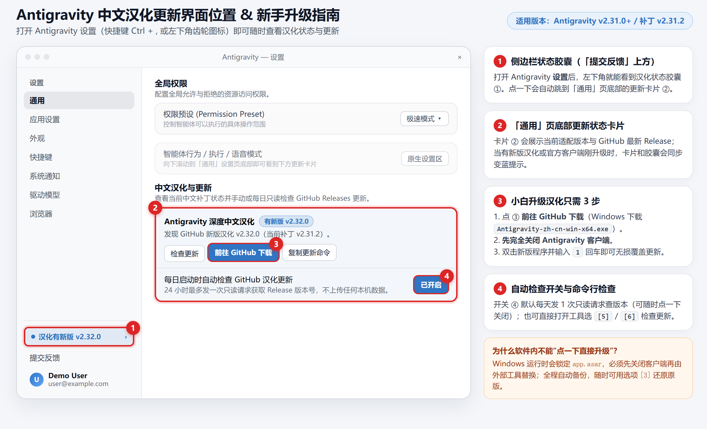

### 本次更新内容（v2.31.6）

- **修复应用内一键下载更新死循环与黑框跳动问题（重大体验优化）**：
  - **进度条实时平滑刷新**：将下载进度与状态深度绑定至渲染签名流，下载期间 `0% ~ 100%` 实时同步渲染，无需手动关闭/重开设置界面即可查看实时进度；
  - **彻底告别黑框弹窗**：采用 Windows 原生无窗口隐身调度器（VBScript WScript.Shell 隐身封装），彻底消除子命令（`ping` / `tasklist` / `find`）导致的黑框闪烁与跳出；
  - **秒级重启与防死循环加固**：热更新触发后主进程采用 `app.exit(0)` 瞬间释放文件占用；后台守护脚本限制最多 4 次轮询强制退出，杜绝死循环，更新完成后秒级静默自动拉起新版客户端；
- **补齐会话与项目历史相对时间动态中文化（v2.31.5 特性）**：
  - 深度解析并汉化侧边栏会话和项目树右侧紧凑相对时间缩写：`6h` / `9h` / `20h` $\rightarrow$ `6小时前` / `9小时前` / `20小时前`、`1d` / `3d` / `5d` $\rightarrow$ `1天前` / `3天前` / `5天前`、`5m` / `15m` $\rightarrow$ `5分钟前` / `15分钟前`、`1w` $\rightarrow$ `1周前`、`1mo` $\rightarrow$ `1个月前`、`1y` $\rightarrow$ `1年前`；
  - 兼容前缀圆点（如 `· 6h` $\rightarrow$ `· 6小时前`）及完整英文短语（如 `9 days ago` $\rightarrow$ `9天前`、`just now` $\rightarrow$ `刚刚`、`yesterday` $\rightarrow$ `昨天` 等）。
- **跨新老版本自适应注入（已实测兼容 `v2.28.2 ~ v2.31.2`）**：
  - 修复旧版（如 `v2.28.2`）下 `dist/tray.js` `Identifier 'translations' has already been declared` 语法错误、`dist/ipcHandlers.js` 缺少 `registerWcvIpcHandlers` 锚点回退、以及同目录存在 `.unpacked` 时重放提取报错的问题；
  - 备份复用校验 `app.asar.original.bak` 与当前客户端版本是否一致，客户端升级后不会误用旧版备份覆盖新版。
- **默认保留官方右上角「更新可用」通道**：
  - 默认选项 **`[1]`** 与命令行 `install` 默认保留官方自动更新（`autoDownload` / `autoInstallOnAppQuit` 开启，并直连主进程 `applyHostUpdate()`），点击 Antigravity 右上角官方 **「更新可用」** 即可下载安装新版，并在右下角显示轻量级原生下载进度提示；下载完成后自动重启应用更新。
  - 官方安装包更新会覆盖 `resources/app.asar`（包括内置汉化与 `提交反馈` 上方状态胶囊）；更新完成后重新运行一次本工具选 **`[1]`**，即可在几秒内为新版 Antigravity 自适应重注全部中文。
  - 如个别用户仅希望手动控制官方更新，可选用选项 **`[2]`** 或命令行 `--block-auto-update`。
- **内嵌式设置页更新体验与应用内热更新**：
  - 状态胶囊（`提交反馈` 上方）与汉化更新卡片仅内嵌在 **设置 -> 通用** 面板中，移除额外悬浮弹窗；新增应用内直接下载新版汉化补丁并一键重启重注能力，并补齐本地热更新备份兼容。

---

## 中文汉化更新入口在哪？新手如何升级？（图文说明）

很多同学更新官方 Antigravity 后不知道在哪里看汉化版本或重新升级汉化，本工具已在 **Antigravity 设置面板** 内直接加入清晰入口：

### 一眼找到汉化更新界面（见上图标注 ① ② ③ ④）

1. **① 左侧边栏底部胶囊**：打开 Antigravity **设置**（左下角齿轮图标或按 `Ctrl + ,`），在左下角 **`提交反馈` 正上方** 即可看到汉化状态胶囊；点击它会自动定位到「`通用`」页底部的汉化卡片（仅在汉化注入后显示；若刚通过官方渠道升级覆盖了原版 `app.asar`，重新运行一次本工具选 `1` 即可恢复）。
2. **② 「通用」页底部「中文汉化与更新」卡片**：展示当前补丁版本、客户端版本及 GitHub 最新版本；支持**应用内一键检查、直接下载最新版补丁并重启更新**。
3. **③ 手动覆盖 / 重注只需 3 步**：
   - 第 1 步：点击卡片内的 **「应用内下载更新」** 或前往 GitHub Release 下载最新 **`Antigravity-zh-cn-win-x64.exe`** 免安装单文件版；
   - 第 2 步：**务必先完全关闭 Antigravity 客户端**（Windows 下运行期间会锁定 `app.asar` 文件；应用内一键重启会自动处理）；
   - 第 3 步：双击 `Antigravity-zh-cn-win-x64.exe`，输入 **`1`** 回车（默认保留官方更新），等待几秒自动重开软件即完成汉化/重注！
4. **④ 每日自动检查开关（可随时关闭）**：默认每 24 小时仅发 1 次只读请求检查 GitHub Releases 版本号（不上传任何本机数据），可在卡片内一键关闭；也可直接运行工具选 **`[5]` 检查 GitHub 最新汉化包更新**。

---

### 本次下载文件说明

| 平台 | 下载文件 | 使用方法 |
| :--- | :--- | :--- |
| **Windows 10/11 (x64)** | `Antigravity-zh-cn-win-x64.exe` | 免安装、无需 Python/Node，关闭 Antigravity 后双击运行选 `1` |
| **Linux (x64)** | `antigravity-zh-cn-linux-x64` | `chmod +x antigravity-zh-cn-linux-x64 && ./antigravity-zh-cn-linux-x64 install` |
| **macOS (Apple Silicon)** | `antigravity-zh-cn-macos-arm64` | `chmod +x antigravity-zh-cn-macos-arm64 && ./antigravity-zh-cn-macos-arm64 install` |
| **校验文件** | `SHA256SUMS.txt` | 用于校验二进制文件完整性 |
