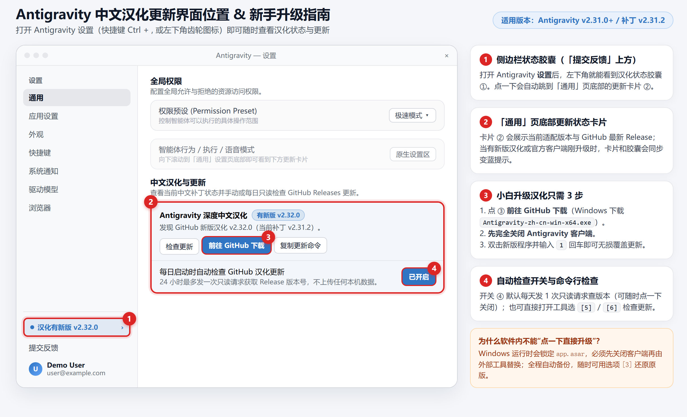

### 本次更新内容（v2.34.3）

- **补全智能体运行期间模型选择器悬浮提示汉化**：
  - 新增 `Model cannot be changed while the agent is running` $\rightarrow$ `智能体运行期间无法切换模型`（同步收录带句号版本）。
- **继承 v2.34.2 及全量适配能力**：
  - 完整支持队列消息（Queued Messages）等待发送区、Antigravity 新模型与编排器（Orchestrator）体系、思考力度、链接打开方式、内置技能描述兜底、`Leaving Soon` / `Leaving on` 下线提示、新版桌面控制浮窗及应用内一键热更新。
- **质量校验**：全量词典扩充至 **6801 条**，E2E 自动化测试（213 项 DOM 断言 + MutationObserver）与主进程模块语法检查全部通过。

---

## 中文汉化更新入口在哪？新手如何升级？（图文说明）

很多同学更新官方 Antigravity 后不知道在哪里看汉化版本或重新升级汉化，本工具已在 **Antigravity 设置面板** 内直接加入清晰入口：

### 一眼找到汉化更新界面（见上图标注 ① ② ③ ④）

1. **① 左侧边栏底部胶囊**：打开 Antigravity **设置**（左下角齿轮图标或按 `Ctrl + ,`），在左下角 **`提交反馈` 正上方** 即可看到汉化状态胶囊；点击它会自动定位到「`通用`」页底部的汉化卡片（仅在汉化注入后显示；若刚通过官方渠道升级覆盖了原版 `app.asar`，重新运行一次本工具选 `1` 即可恢复）。
2. **② 「通用」页底部「中文汉化与更新」卡片**：展示当前补丁版本、客户端版本及 GitHub 最新版本；支持**应用内一键检查、直接下载最新版补丁并重启更新**。
3. **③ 手动覆盖 / 重注只需 3 步**：
   - 第 1 步：点击卡片内的 **「应用内下载更新」** 或前往 GitHub Release 下载最新 **`Antigravity-zh-cn-win-x64.exe`** 免安装单文件版；
   - 第 2 步：**务必先完全关闭 Antigravity 客户端**（Windows 下运行期间会锁定 `app.asar` 文件；应用内一键重启会自动处理）；
   - 第 3 步：双击 `Antigravity-zh-cn-win-x64.exe`，输入 **`1`** 回车（默认保留官方更新），等待几秒自动重开软件即完成汉化/重注！
4. **④ 每日自动检查开关（可随时关闭）**：默认每 24 小时仅发 1 次只读请求检查 GitHub Releases 版本号（不上传任何本机数据），可在卡片内一键关闭；也可直接运行工具选 **`[5]` 检查 GitHub 最新汉化包更新**。

---

### 本次下载文件说明

| 平台 | 下载文件 | 使用方法 |
| :--- | :--- | :--- |
| **Windows 10/11 (x64)** | `Antigravity-zh-cn-win-x64.exe` | 免安装、无需 Python/Node，关闭 Antigravity 后双击运行选 `1` |
| **Linux (x64)** | `antigravity-zh-cn-linux-x64` | `chmod +x antigravity-zh-cn-linux-x64 && ./antigravity-zh-cn-linux-x64 install` |
| **macOS (Apple Silicon)** | `antigravity-zh-cn-macos-arm64` | `chmod +x antigravity-zh-cn-macos-arm64 && ./antigravity-zh-cn-macos-arm64 install` |
| **校验文件** | `SHA256SUMS.txt` | 用于校验二进制文件完整性 |
