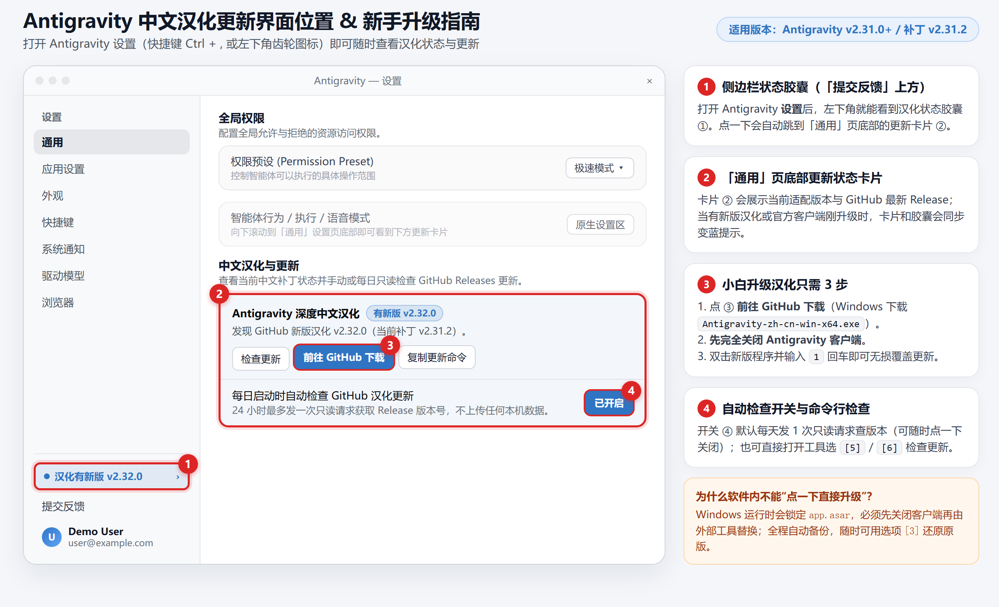

# Antigravity 一键中文汉化工具 (`antigravity-zh-cn`)

**简体中文** | [English](README_EN.md)

> 专为 **Antigravity** 打造的免费开源中文汉化工具。**无需配置 Python 或其他环境**，下载后双击即可一键汉化（实测兼容 `v2.28.2 ~ v2.31.2`），汉化前自动备份原文件，随时可无损还原为官方英文版。

---

## 快速开始（3 步完成）

### 第 1 步：下载汉化工具

前往 [**GitHub Releases**](../../releases) 下载对应系统的程序：

- **Windows**：下载 `Antigravity-zh-cn-win-x64.exe`
- **macOS (Apple Silicon)**：下载 `antigravity-zh-cn-macos-arm64`
- **Linux (x64)**：下载 `antigravity-zh-cn-linux-x64`

### 第 2 步：关闭客户端并一键汉化

**请先完全退出 Antigravity**（避免程序文件被占用），然后运行工具：

- **Windows 用户**：双击 `Antigravity-zh-cn-win-x64.exe`，输入 **`1`** 并按回车，等待几秒自动完成。
- **macOS / Linux 用户**：在终端中执行（以 macOS 为例，Linux 请替换文件名）：
  ```bash
  chmod +x antigravity-zh-cn-macos-arm64
  ./antigravity-zh-cn-macos-arm64 install
  ```

> 💡 如果你的 Antigravity 安装在 `C:\Program Files\` 或 `/opt/` 等系统目录，Windows 请**右键以管理员身份运行**，macOS / Linux 请在命令前加 `sudo`。

### 第 3 步：安装官方基础中文语言包（推荐）

为了把编辑器顶部菜单和基础设置也变成中文，请在 Antigravity 左侧 **扩展（Extensions）** 中搜索并安装微软官方插件：

**`Chinese (Simplified) (简体中文) Language Pack for Visual Studio Code`**

安装后按提示切换语言并重启，即可获得完整的全中文界面。

---

## 更新与还原

- **还原为官方英文原版**：关闭 Antigravity 后运行工具，输入 **`3`** 回车（命令行运行 `restore`）即可无损恢复。
- **官方升级后变回英文了怎么办？**：Antigravity 官方更新会覆盖内置界面文件，关闭软件后重新运行本工具选 **`1`** 即可恢复中文，不会影响原有设置和对话记录。
- **如何检查汉化新版？**：汉化后打开 Antigravity **设置（`Ctrl + ,`）→ 通用** 页面最底部，即可看到「**中文汉化与更新**」卡片，支持应用内一键检查与更新（也可在工具菜单选 **`5`** 检查）。

<details>
<summary>点击查看：设置里的「中文汉化与更新」入口位置示意图</summary>



</details>

---

## 常见问题

- **安全吗？会上传数据或影响账号吗？**
  工具仅在本地修改界面显示文本，**不修改任何账号逻辑，也不上传任何本机数据**（设置页的更新检查默认每天仅向 GitHub 请求一次最新版本号，可在开关中随时关闭）。
- **工具菜单里选项 `[1]` 和 `[2]` 有什么区别？**
  选 **`[1]`（推荐）** 会正常保留 Antigravity 右上角的官方「更新可用」一键升级功能；选 **`[2]`** 则禁止后台自动下载官方更新，仅在你主动点击后才下载。

---

<details>
<summary>开发者与命令行高级用法（普通用户可忽略）</summary>

### 1. 环境要求与源码运行

- **环境要求**：Python 3.8+（免安装单文件版无需 Python）；可选 Node.js 18+（仅用于 `node --check` 语法复检与运行测试）。
- **Windows 一键批处理**：下载仓库后双击 [`scripts/Antigravity一键汉化工具.bat`](scripts/Antigravity一键汉化工具.bat)。
- **macOS / Linux 脚本**：运行 `chmod +x scripts/localize.sh && ./scripts/localize.sh install`。

### 2. 常用命令行参数 (`src/localize.py`)

```bash
python src/localize.py status                      # 查看当前安装检测与汉化状态
python src/localize.py check-update                # 检查 GitHub 是否有新版汉化发布
python src/localize.py install                     # 备份原版并注入深度汉化（保留官方更新通道）
python src/localize.py install --block-auto-update # 注入汉化并禁止后台静默下载官方更新
python src/localize.py restore                     # 从 app.asar.original.bak 无损还原官方原版
python src/localize.py install --app-dir "/path/to/Antigravity"  # 指定安装目录
python src/localize.py install --asar "/path/to/resources/app.asar" # 直接指定 app.asar
```

### 3. 离线打包与自动化测试

```bash
# 对指定 app.asar 离线打包（不改动本机安装；若含 unpacked 目录请保证同级存在 .unpacked）
python src/localize.py build --input-asar "/path/to/vanilla/app.asar" --output-asar "/path/to/output/app.asar"

# 运行纯 Node.js DOM 沙箱端到端测试（Node.js 18+）
npm test
# 可选：同时校验解包后的 dist/ 主进程模块
node tests/verify_e2e.js --dist-dir "/path/to/extracted/dist"
```

### 4. 核心实现与目录结构

- 内置 **6,658 条** UI 词典（`dict/master_merged_dict.json`），覆盖前端动态 DOM / Shadow DOM（`src/engine_preload.js`）与 Electron 主进程菜单、托盘、右键菜单、更新器及 Passkey 提示（`src/patches_main.py`）。
- 内置纯 Python ASAR 编解码器（`src/asar_codec.py`），支持 SHA-256 完整性校验，普通用户无需安装 Node.js。

```text
├── dict/master_merged_dict.json          # 主界面翻译词典
├── docs/images/update-ui-guide.png       # 汉化更新入口示意图
├── scripts/                              # Windows 批处理、Shell 入口与单文件打包脚本
├── src/                                  # 核心引擎（localize.py / asar_codec.py / patches_main.py / engine_preload.js）
├── tests/                                # 单元测试与 E2E 自检脚本
├── CONTRIBUTING.md                       # 贡献与词典提交流程
└── LICENSE                               # MIT 开源许可证
```

</details>

---

## 免责声明与开源协议

本项目仅提供本地 UI 汉化脚本与词典，与 Google / Antigravity 官方无任何从属关系；仓库内不包含任何官方程序或安装包，请从官方渠道获取正版客户端。

基于 [MIT License](LICENSE) 开源，欢迎通过 Issue / PR 补充漏翻截图或优化词条。
