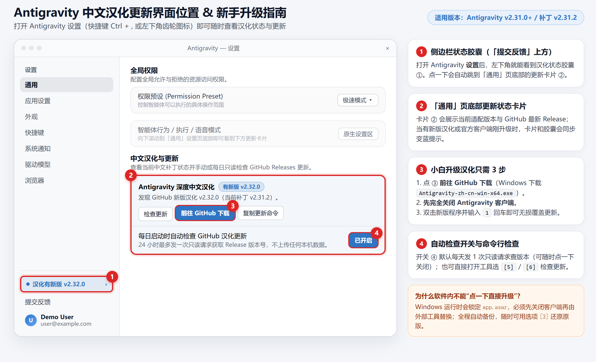

# Antigravity Chinese Localization Patcher (`antigravity-zh-cn`)

[简体中文](README.md) | **English**

> A free, open-source Simplified Chinese localization tool for **Antigravity**. **No Python or Node.js required** with the standalone release—just download, run, and patch (tested on `v2.28.2 ~ v2.31.2`). Original files are backed up automatically so you can restore anytime.

---

## Quick Start (3 Steps)

### 1. Download the Patcher

Download the binary for your OS from [**GitHub Releases**](../../releases):

- **Windows**: `Antigravity-zh-cn-win-x64.exe`
- **macOS (Apple Silicon)**: `antigravity-zh-cn-macos-arm64`
- **Linux (x64)**: `antigravity-zh-cn-linux-x64`

### 2. Close Antigravity & Apply the Patch

**Completely quit Antigravity first** so `app.asar` is not locked, then run the tool:

- **Windows**: Double-click `Antigravity-zh-cn-win-x64.exe`, enter **`1`**, and press Enter.
- **macOS / Linux** (example for macOS; swap filename for Linux):
  ```bash
  chmod +x antigravity-zh-cn-macos-arm64
  ./antigravity-zh-cn-macos-arm64 install
  ```

> 💡 If Antigravity is installed in a system-protected folder (e.g. `C:\Program Files\` or `/opt/`), run as Administrator on Windows or prefix with `sudo` on macOS/Linux.

### 3. Install Microsoft's Base Chinese Pack (Recommended)

Open **Extensions** inside Antigravity, search for and install:

**`Chinese (Simplified) (简体中文) Language Pack for Visual Studio Code`**

Switch the display language when prompted and restart to localize the base VS Code menus as well.

---

## Update & Restore

- **Restore to English**: Quit Antigravity, re-run the tool, and choose **`3`** (or run `restore` via CLI).
- **After an official Antigravity update**: Official updates overwrite `app.asar` back to English. Simply quit Antigravity and re-run option **`1`** (`install`)—your settings and chat history stay intact.
- **Check for patch updates**: Open Antigravity **Settings (`Ctrl + ,`) -> General** and scroll to the bottom for the **中文汉化与更新** card, or select **`5`** in the tool menu.

<details>
<summary>Preview: Where to find the in-app localization update card</summary>



</details>

---

## FAQ

- **Is it safe?**
  It only modifies local UI strings, ships no proprietary binaries, and sends no local telemetry (the optional in-app update check makes at most one read-only GitHub Releases API request per day and can be toggled off anytime).
- **What is the difference between menu `[1]` and `[2]`?**
  **`[1]` (Recommended)** keeps Antigravity's built-in top-right official update button working normally; **`[2]`** blocks background auto-downloads until you click to update manually.

---

<details>
<summary>Advanced Usage, CLI & Developer Notes</summary>

### 1. Running from Source

- **Requirements**: Python 3.8+ (optional Node.js 18+ for JS syntax verification & E2E tests).
- **Windows wrapper**: Double-click `scripts/Antigravity一键汉化工具.bat`.
- **macOS / Linux wrapper**: `chmod +x scripts/localize.sh && ./scripts/localize.sh install`.

### 2. CLI Commands (`src/localize.py`)

```bash
python src/localize.py status                      # Inspect installation & localization status
python src/localize.py check-update                # Check GitHub for newer localization releases
python src/localize.py install                     # Backup & apply localization (keeps official updates)
python src/localize.py install --block-auto-update # Apply localization & block background downloads
python src/localize.py restore                     # Lossless rollback from app.asar.original.bak
python src/localize.py install --app-dir "/path/to/Antigravity"
python src/localize.py install --asar "/path/to/resources/app.asar"
```

### 3. Offline Build & E2E Verification

```bash
# Build localized ASAR offline without modifying local installation
python src/localize.py build --input-asar "/path/to/vanilla/app.asar" --output-asar "/path/to/output/app.asar"

# Run automated E2E DOM + dictionary checks (Node.js 18+)
npm test
node tests/verify_e2e.js --dist-dir "/path/to/extracted/dist"
```

### 4. Architecture Overview

- Includes a **6,658-entry** UI dictionary (`dict/master_merged_dict.json`), a dynamic Shadow DOM & regex translation engine (`src/engine_preload.js`), native main-process patches (`src/patches_main.py`), and a pure-Python ASAR codec (`src/asar_codec.py`) with SHA-256 verification.

</details>

---

## Disclaimer & License

This project provides local UI localization scripts and dictionaries only and is not affiliated with Google or Antigravity. No official proprietary binaries are distributed here.

Licensed under the [MIT License](LICENSE).
